# Tram backup odometry — hackathon technical report

```text
Built only from saved evidence files (no TEST replay, no retuning).
Evidence status labels are ours, NOT an official jury score.

```

## CRITERION 1 - VELOCITY ACCURACY (0-30)

```text
Measures: estimated longitudinal speed vs GNSS master speed on held-out TEST bags;
error = estimate - GNSS; causal replay of the same core used by the ROS node.
Held-out test bags: 20/20    matched samples: 223335
MAIN (all matched samples):  RMSE 0.0701 m/s   MAE 0.0291 m/s   bias -0.0190 m/s   max |e| 12.057 m/s
Alternative, labelled FILTERED (rover agrees with master within 0.5 m/s): RMSE 0.0519  MAE 0.0287  bias -0.0194  n=221641
Baseline (mean of wheels /3.6): RMSE 0.0839  MAE 0.0413

Regime (from GNSS reference)   samples     RMSE      MAE      bias
  acceleration                    54433  0.0563   0.0338   -0.0190
  braking                         53444  0.0652   0.0374   -0.0221
  steady                          43156  0.0629   0.0429   -0.0339
  stop                            68864  0.0868   0.0102   -0.0070
  stop, FILTERED (see above)      68287  0.0185   0.0089   -0.0082
  (raw stop RMSE is dominated by 27 master-GNSS dropouts to ~0 m/s while rover agrees with the estimate)
Live ROS /result/velocity vs offline replay: RMSE 0.0022 m/s, max 0.020 m/s (30618_d4ba7005, 79 s)
/result/velocity publication rate: 20.0 Hz
Plots: results/velocity_eval/velocity_comparison.png, results/velocity_eval/velocity_error.png, results/velocity_eval/velocity_zoom_transients.png, results/velocity_eval/regime_metrics.png, results/velocity_eval/live_vs_offline.png

```

## CRITERION 2 - POSITION ACCURACY (0-35)

```text
Measures: horizontal position vs GNSS master fix after the 3 s GNSS initialisation window;
along/cross = error components relative to local GNSS travel direction (not graph station error).
Split (results/splits.json): train 57 / dev 20 / test 20
Path map: src/tram_odometry/config/train_path_map.json  (7379 directed nodes; source: TRAIN GNSS master fixes only, 37 train bags)
DEV coverage (audited, pooled moving samples within 3 m): 96.72%
DEV lateral RMSE (audited, covered samples): 0.432 m     DEV failures >50 m: 30618_21dd3af3
TEST bags evaluated: 20

MEDIAN PER-BAG (TEST, train map)                     NO MAP (same bags)
  final position error          7.55 m                 4926.0 m
  position RMSE                 4.89 m                 3000.0 m
  position MAE                  4.41 m
  along mean/RMSE/max      -4.45 / 4.84 / 23.12 m
  cross mean/RMSE/max      -0.07 / 1.16 / 5.72 m
  final drift              0.137% of GNSS fix-path length - denominator unreliable; whole-run drift NOT VERIFIED
                           (alt. endpoint error / covered GNSS-speed distance: 0.144%, different coverage)
POOLED (all TEST samples)
  position RMSE                50.51 m (audit-corrected)   no map 4229.2 m
  along/cross pooled       NOT VERIFIED
GLOBAL MAXIMUM (TEST)
  worst final error           176.91 m                 9860.7 m
  max |along| / |cross|    221.6 / 195.7 m
Failure threshold final >30 m: 6 bags: 30618_a869780d, 30618_defd0170, 30618_0686195f, 30618_88548b02, 30618_27e994fc, 30639_0be558e2
                  final >50 m: 5 bags
Runtime with path_map_file: VERIFIED (short DEV run) - 30618_af7496f0, 20 s, 386 finite msgs, status 'ok; path_map'
Plots: results/route_eval/route_map.png, results/route_eval/dev_route_overlay.png, results/route_eval/test_trajectory_comparison.png, results/route_eval/along_track_error.png, results/route_eval/cross_track_error.png

```

## CRITERION 3 - SLIP / ANOMALY ROBUSTNESS (0-20)

```text
Measures: behaviour under injected wheel faults on a synthetic analytic speed profile (not real labelled slip).
Pre-declared pass criteria: Declared before running: finite, no exceptions, state time advances at every 20Hz tick, error <=1m/s, distance deviation <=10m, recovery <=5s sustained for 1s, sane wheels accepted.
Synthetic scenarios: 15   passed: 13   failed: 2
  FAILED forward_header_spike: max speed error 3.197 m/s, distance deviation 580.4 m, recovery never
  FAILED both_slip_long: max speed error 5.190 m/s, distance deviation 55.1 m, recovery 3.4 s

  Capability                         Status         Evidence
  Front/rear disagreement detection  YES            front_slip_5mps, moderate_disagreement PASS; slip flag set
  Model residual detection           PARTIAL        both_slip_short PASS; both_slip_long FAIL (sustained consistent slip reacquired)
  Jump/outlier rejection             YES            front_spike, rear_spike PASS; rejected inputs change speed by 0.0 m/s
  Trust reduction/downweighting      YES            R x9 on disagreement; update ratio 0.54
  Model fallback                     YES            both_missing PASS; model_only observed in ROS
  Stale/missing-input handling       YES            both_missing, rear_missing_long, command_missing PASS; command_stale observed in ROS
  Recovery                           PARTIAL        recovery <=0.5 s in passing cases; forward_header_spike never recovers
  Diagnostics/slip status            YES            /result/diagnostics slip flag, model_only, invalid counts observed in ROS
  ROS crashes                        NONE OBSERVED  short real-bag + synthetic ROS runs alive, exit codes [0, 0]
  NaN/Inf outputs                    NONE OBSERVED  all 15 cases finite; ROS outputs finite
  Real labelled slip validation      NOT VERIFIED   no labels supplied
  Slip-ratio estimation              NO             not implemented
  Adhesion-coefficient estimation    NO             not implemented
Unit tests (robustness audit): 15 passed, 0 failed
Plots: results/robustness_eval/scenario_plots.png, results/final_demo/robustness_summary.png

```

## CRITERION 4 - REAL-TIME PERFORMANCE (0-15)

```text
Measures: short ROS 2 run, bag 30618_af7496f0, node process only.
/result/velocity rate: 20.00 Hz    /result/position rate: 20.00 Hz    max output interval: 56.1 ms
CPU mean 13.8%  sampled peak 19.9%  -> effective cores mean 0.138, peak 0.199 (limit 2)
RSS mean 61.0 MB, max 61.0 MB (limit 500 MB)
Observation duration: 45.0 s    short-run alive: True
Build without internet: VERIFIED (colcon exit 0, 63 s, network-restricted; results/performance/build.log)
LATENCY PROXY (observer receipt of input -> next output; NOT verified causal latency):
  -> /result/velocity  mean 9.40 ms  median 9.46 ms  max 14.51 ms
  -> /result/position  mean 9.84 ms  median 9.96 ms  max 15.80 ms
Causal latency <=100 ms: NOT VERIFIED
Causal peak <=250 ms: NOT VERIFIED
Long-term stability: NOT VERIFIED
Plots: results/final_demo/performance_summary.png

```

## SUMMARY

```text
Criterion                  Result                                                                     Evidence status
----------------------------------------------------------------------------------------------------------------
Velocity accuracy          RMSE 0.070 m/s, MAE 0.029, bias -0.019 (20 test bags)                      strong
Position accuracy          median final 7.6 m, pooled RMSE 50.5 m; 6/20 bags >30 m                    partial
Slip/anomaly robustness    13/15 synthetic PASS; no real slip labels                                  partial
Real-time performance      20 Hz, 0.20 cores peak, 61 MB; causal latency NOT VERIFIED                 partial

Strongest verified results:
  - Velocity RMSE 0.0701 m/s on 20 held-out bags, 16.5% below wheel-mean baseline; live ROS matches offline (RMSE 0.0022 m/s).
  - Train-only map: median final position error 7.6 m vs 4926 m without map.
  - 20 Hz output, 0.20 CPU cores peak, 61 MB RSS; no crashes or NaN/Inf observed.
NOT VERIFIED:
  - causal latency <=100 ms and peak <=250 ms
  - long-term stability (only ~45 s runs)
  - whole-run position drift %; pooled along/cross-track metrics
  - real labelled slip; slip ratio / adhesion not implemented
  - organiser permission to use a map built from training GNSS
Known failures/limitations:
  - position: 6 test bags >30 m final error (30618_a869780d, 30618_defd0170, 30618_0686195f, 30618_88548b02, 30618_27e994fc, 30639_0be558e2); dev bag 30618_21dd3af3 never engages the map
  - robustness: forward_header_spike (3.20 m/s, 580 m); both_slip_long (5.19 m/s, 55 m)
  - velocity: small negative bias (-0.02 m/s); 3 test bags with RMSE >0.1 m/s
  - map fallback heading for stationary starts is applied after follower initialisation (audit finding, not fixed)

EVIDENCE INCONSISTENCIES:
  - Position pooled RMSE: route_eval/test_summary.json 50.53 m vs audit-corrected 50.51 m (audit recomputed from CSV totals; audit value used)

Evidence documents: docs/VELOCITY_EVAL.md, docs/ROUTE_EVAL.md, docs/ROBUSTNESS_EVAL.md, results/performance/performance.txt

Self-check: protected files unchanged=True; missing plots=none
```

## Plots

### Velocity

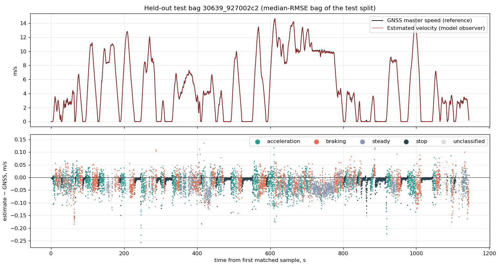
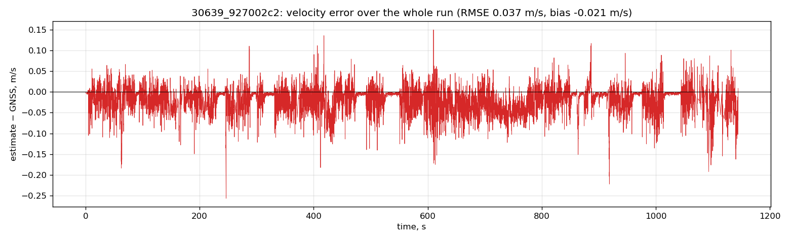
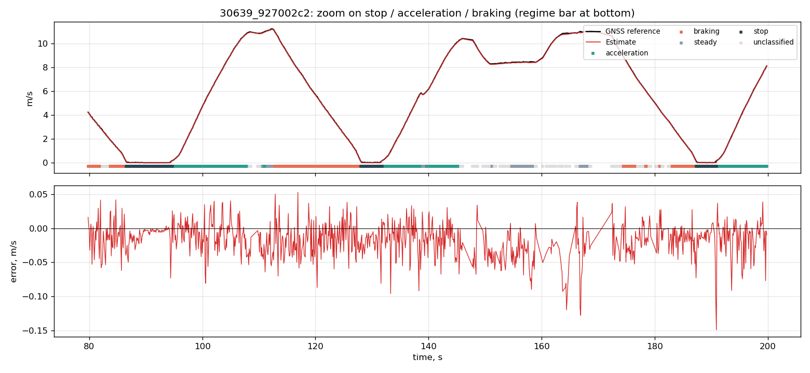
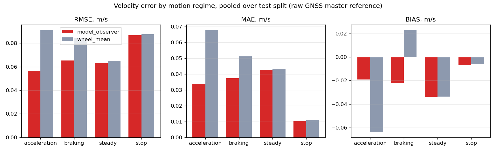
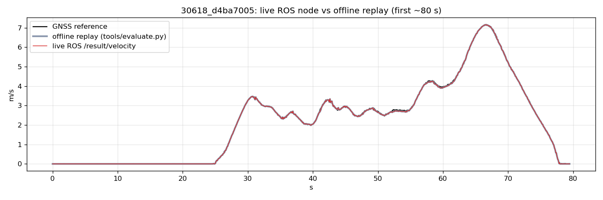

### Position

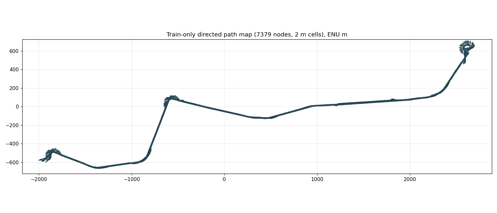
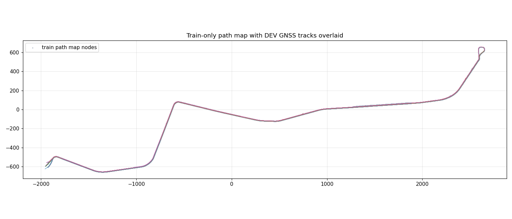
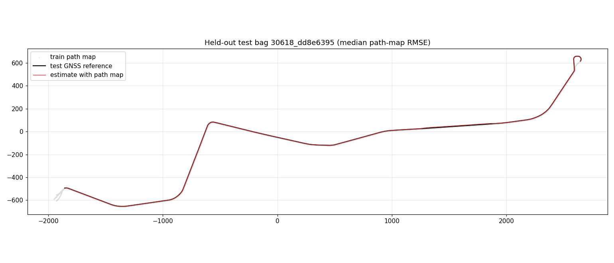
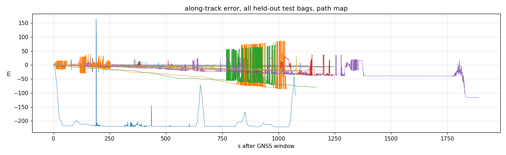
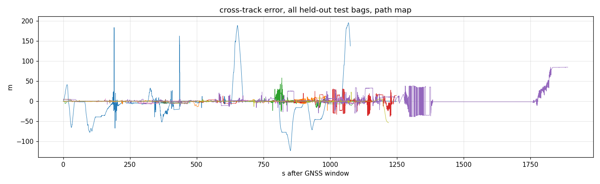

### Robustness

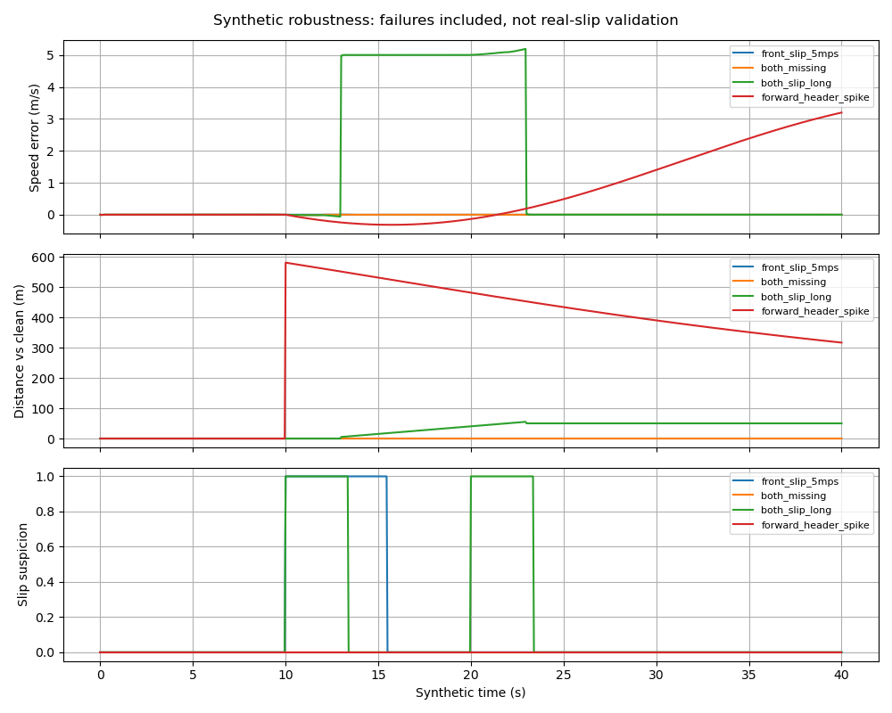
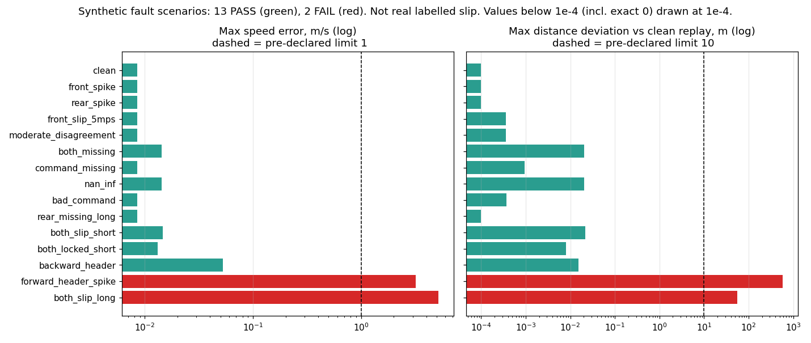

### Performance

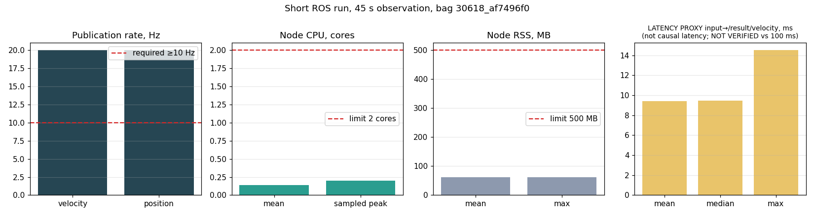

